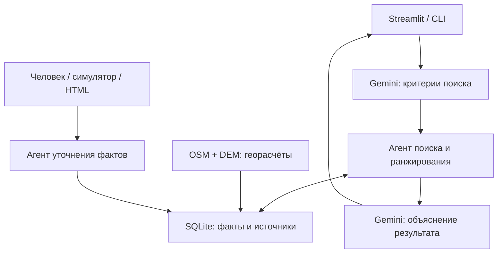

# Hotel Insight AI

**Поиск отелей по тому, чего нет в стандартных фильтрах.**

[](https://github.com/Just-Maxx/hotel-insight-ai/actions/workflows/tests.yml)


> «Хочу тихий номер с видом на закат, а до пляжа — не больше десяти минут пешком».

Мультиагентная система превращает свободный запрос в критерии, сопоставляет их с
геоданными и сохранёнными фактами об отелях, а затем объясняет результат.
Gemini отвечает за понимание естественного языка и формулировку объяснения;
геометрия, пешие маршруты и рейтинг рассчитываются Python-кодом.

[Быстрый старт](#быстрый-старт) · [Архитектура](#архитектура) ·
[Тестирование](#тестирование) · [Подробная установка](docs/SETUP.md)

## Возможности

| Критерий | Что проверяет система |
|---|---|
| Вид на море | Долю сектора обзора с видимой водой по фасадам и пробным этажам |
| Вид на закат | Видимость заката по месяцам, фасадам и этажам |
| Тишина | Приблизительный шум от дорог, железной дороги и других источников |
| Пешая доступность | Время до пляжа, остановки или станции по сети путей с учётом уклона |
| Ночная инфраструктура | Наличие доступных заведений с указанными часами работы |
| Удобства для детей | Площадки, пешеходные зоны и детская медицина |
| Проживание с животными | Условия из ответов отельера: виды, вес, доплата и согласование |

В Streamlit доступны поиск, сравнение отелей, карта, кабинет отельера и сведения
об актуальности данных. Каждый факт хранит источник, дату, уверенность и срок
актуальности. Расхождения между источниками отмечаются явно.

## Быстрый старт

Рекомендуется Python 3.11+. Команды ниже — для macOS и Linux;
[инструкция для Windows](docs/SETUP.md#1-установка-и-настройка).

```bash
git clone https://github.com/Just-Maxx/hotel-insight-ai.git
cd hotel-insight-ai
python3 -m venv .venv
source .venv/bin/activate
python -m pip install -r requirements.txt
cp .env.example .env
```

Заполните `GEMINI_API_KEY` в `.env`. Модель задаётся через `GEMINI_MODEL` и должна
быть доступна вашему API-ключу. Секреты не входят в репозиторий.

В комплекте — JSON с восемью **вымышленными** отелями и синтетическая сцена.
При первом запуске импортируйте их в локальную SQLite-БД. Этот блок сохраняет
уже существующую БД по стандартному пути:

```bash
if [ ! -f data/demo/facts.db ]; then
  python scripts/import_hotels.py data/demo/hotels.json --city Сочи &&
  python scripts/seed_hotelier_demo.py
fi
python -m streamlit run app/streamlit_app.py
```

Откройте адрес, который выведет Streamlit — обычно `http://localhost:8501`.
Для консольного поиска, из второго терминала с активированным окружением:

```bash
python main.py "Хочу море в пешей доступности в Сочи"
```

Gemini — основной парсер запроса. При отсутствии ключа, ошибке API или невалидном
ответе система явно сообщает о резервном режиме, показывает доступные результаты
либо задаёт уточняющий вопрос. Офлайн-разбор ограничен типовыми формулировками.

## Архитектура



- **Оркестратор** извлекает требования, город и ограничения из естественного языка.
- **Агент поиска** использует сохранённые факты и учитывает важность требований.
  «Вид на море» и «пляж в десяти минутах» обрабатываются как разные условия.
- **Коммуникационный агент** задаёт вопросы, извлекает факты с цитатами и сохраняет
  неопределённость и противоречия. Реальные сообщения и звонки не отправляются.
- **Геоконвейер** заранее готовит характеристики из OpenStreetMap и Copernicus DEM.
  Обычный пользовательский поиск не скачивает весь район заново.
- **Хранилище** сопоставляет источники, отмечает устаревание и расхождения.

## Надёжность LLM

Пустой JSON, частичный план, неизвестное пожелание, таймаут и ошибки 429/503
обрабатываются отдельно. Код гарантирует запуск поиска по валидным критериям,
даже если модель не создала задачу исполнителю. Неподдерживаемые пожелания не
выдаются за выполненные, а неизвестные значения не превращаются в ноль.

Проверить реальное обращение к Gemini:

```bash
python scripts/check_gemini_search.py --query "Хочу море в пешей доступности"
```

`ONLINE PASS` означает успешный сценарий через API. Резервная выдача не считается
успешным онлайн-тестом. Вызовы расходуют квоту ключа.
[Контракт и сценарии отказов](docs/GEMINI_SEARCH.md).

## Тестирование

```bash
python scripts/run_tests.py
```

Команда создаёт временную копию проекта и синтетическую БД, затем запускает
тесты без запросов к Gemini. Рабочие данные и настройки не меняются.
В CI тот же набор выполняется при push и pull request.

Проверки охватывают георасчёты, маршруты, поиск, интеграцию с БД, диалоговые
сценарии, ошибки LLM и сценарии интерфейса через Streamlit AppTest.

## Реальные геоданные

Для загрузки района Адлера / Сочи:

```bash
python -u scripts/build_demo.py --bbox 43.40 39.90 43.46 39.98 --limit 15 --rebuild
```

Успешные ответы кэшируются локально; после прерывания можно повторить команду.
Сбойные участки записываются в отчёт, а зависимые характеристики помечаются
как неполные. Публичные Overpass-серверы могут отвечать медленно или отказывать.

**Сборка заменяет демонстрационные JSON и сцену. Импорт по умолчанию очищает
выбранную БД.** Проверка покрытия, импорт в отдельную БД и команды продолжения —
в [инструкции по данным](docs/SETUP.md#4-загрузка-реальных-данных-адлера--сочи).
Сырой кэш, локальные БД и API-ключи в Git не включены.

## Структура

| Папка | Назначение |
|---|---|
| `agents/` | Оркестрация, поиск, диалог и резервный разбор |
| `core/`, `schemas/` | Клиент Gemini, промпты, реестр и контракты данных |
| `tools/geo/` | Видимость, шум, пешие маршруты, POI и сборка сцены |
| `storage/` | SQLite, источники, конфликты, актуальность и очередь вопросов |
| `app/` | Интерфейс Streamlit |
| `simulator/` | Вымышленные сценарии отельеров |
| `scripts/`, `tests/`, `eval/` | Подготовка данных, проверки и оценка качества |
| `docs/` | Установка, LLM-поиск и коммуникационный модуль |

## Ограничения

Это исследовательский прототип. Высоты зданий и рельеф приблизительны, модель
шума не откалибрована. Расчёт не подтверждает вид из конкретного доступного номера
и не учитывает цены или наличие мест. Уверенность — условная оценка, а не
вероятность правильного ответа. Цитата источника не доказывает его достоверность.

Метрики в `eval/` относятся к синтетической сцене: для реального района необходима
отдельная разметка. Проверки интерфейса через AppTest не заменяют визуальную оценку
в браузере. Карта может загружать подложку через интернет.

## Командная разработка

Проект создан командой. Эта версия оформлена как личный репозиторий для
демонстрации совместно разработанной системы и инженерных решений.
Подробности коммуникационного модуля — в [docs/COMMUNICATION.md](docs/COMMUNICATION.md).
